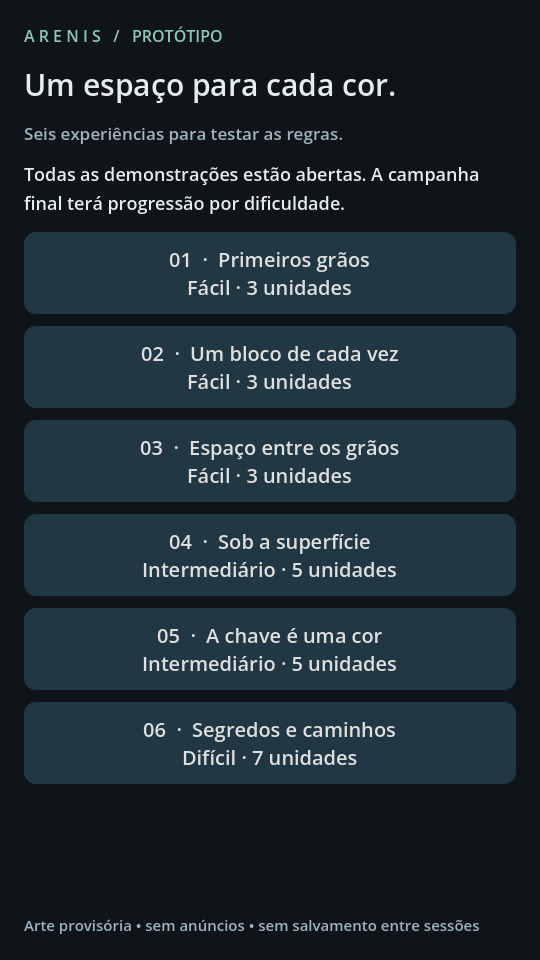
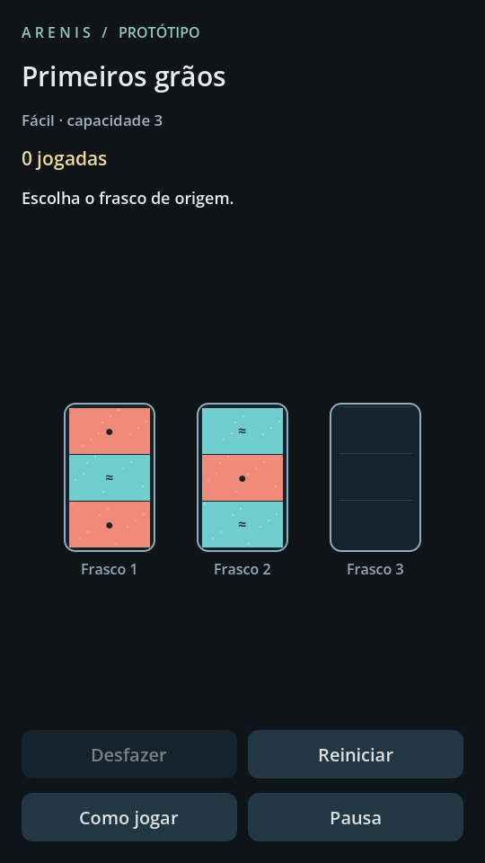
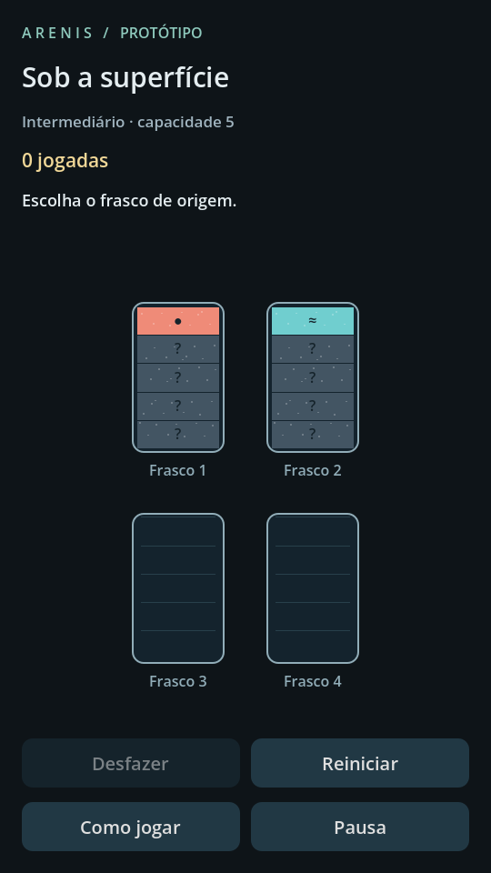
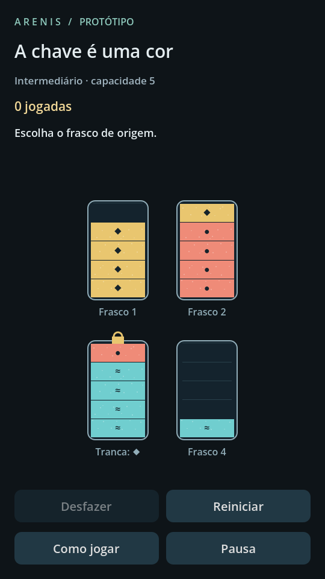
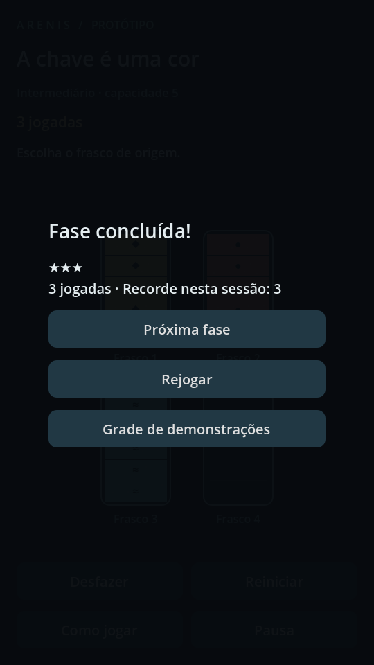

# Relatório da fase 1 — Protótipo jogável

Data: 12/11/2026. Modelo: GPT-6.1 Sol, esforço médio.

## Entrega

Protótipo jogável em Godot 4.7.2 padrão, GDScript e renderizador Compatibility, com orientação retrato 540 × 960 de referência. Execução verificada em Windows; exportação e verificação em Android ficam para a fase de integrações.

O projeto abre pela cena principal e oferece seis demonstrações. Cada uma tem uma explicação pulável, e o jogador pode selecionar origem/destino, cancelar seleção, visualizar destinos válidos, desfazer, reiniciar, pausar e concluir. Jogadas inválidas preservam a seleção e não alteram o contador.

O despejo é calculado de forma determinística, transfere o máximo possível do bloco superior e conta uma jogada. A interface representa a transferência com uma corrente de grãos e impede comandos concorrentes durante a animação. Os frascos exibem símbolos além das cores.

Há areia escondida com revelação de blocos superiores, trancas condicionadas à conclusão da cor indicada, desbloqueios em cadeia, vitória e estrelas nos limites aprovados. Desfazer recupera as trancas e preserva conhecimento; reiniciar restaura os segredos. Resultados mostram jogadas e recorde da sessão, com próxima fase, rejogar e retorno à grade.

## Arquivos principais

- `project.godot` e `scenes/main.tscn`: configuração e entrada do projeto.
- `scripts/rules.gd`: núcleo das regras independente de cena e animação.
- `scripts/main.gd`: seleção de demonstrações e fluxo jogável.
- `scripts/bottle.gd`: frascos, símbolos, estados de seleção e tranca.
- `scripts/stream.gd`: animação visual de grãos.
- `data/prototype_levels.json`: seis fases versionadas e seus mínimos.
- `tests/rules_test.gd`: verificações do núcleo e busca exaustiva das demonstrações.
- `tests/ui_test.gd`: fluxo de interface por callbacks no Godot headless.
- `tests/capture_preview.gd`: captura reproduzível das telas em display gráfico.
- `tools/play.ps1` e `tools/check.ps1`: execução e verificação.
- `README.md`: instruções para abrir e jogar.

## Verificação realizada

- Godot executado: `4.7.2.stable.official.ed1daf0bf`.
- Regras: **85 verificações, zero falhas**.
- Interface: **13 verificações, zero falhas**.
- Seis demonstrações com soluções reproduzidas até a vitória e desfazer completo até o estado inicial.
- Mínimos comprovados por busca em largura, usando o próprio núcleo de regras: 5, 3, 2, 9, 3 e 3 jogadas, na ordem da seleção de demonstrações.
- Casos cobertos: despejo parcial, capacidade máxima, cor incompatível, origem igual ao destino, índices inválidos, histórico, revelação, leitura de índices ocultos do JSON, reinício, trancas, cascatas e limites inteiros de estrelas.
- Fluxo de interface coberto: seleção, retorno inválido, bloqueio durante animação, desfazer, vitória, rejogar, pausa e retorno à lista.
- Renderização gráfica OpenGL executada em Windows com AMD Radeon RX 6600 XT. Cinco telas capturadas; menu, tabuleiros com areia normal/oculta/trancas e resultado inspecionados visualmente.

As verificações da interface invocam callbacks; não substituem testes manuais de toque, gesto Voltar, desempenho ou interrupções em aparelhos Android.

## Decisões técnicas

O núcleo usa identificadores estáveis para cada unidade de areia. O conhecimento fica separado dos snapshots de desfazer. Índices lidos do JSON são normalizados para inteiros, evitando revelar incorretamente unidades ocultas.

A ordem da jogada ficou definida como transferência, revelação dos blocos expostos, desbloqueios até estabilizar e avaliação da vitória. Trancas abertas permanecem abertas até o desfazer correspondente ou reinício.

Os mínimos das demonstrações foram comprovados com uma busca pequena nos testes. Essa ferramenta não é o solver de produção da campanha de 150 fases; a fase 2 deve tratar desempenho, validação de autoria, limites e evidência de mínimo.

A arte é provisória e não usa os estudos antigos como identidade aprovada. A criação final do mascote permanece na fase visual dedicada.

## Limitações e pendências

- Execução desktop no Godot; ainda sem APK, export templates, configuração de assinatura ou validação Android.
- Todas as demonstrações ficam disponíveis para testar mecânicas; ainda sem campanha e desbloqueio sequencial.
- Partidas e recordes existem apenas na sessão. Fechar o jogo ou voltar à lista perde a partida em andamento. Persistência por dificuldade entra na fase 4.
- Ainda sem mascote, identidade final, temas, idiomas adicionais, áudio, nuvem ou anúncios.
- As explicações são painéis puláveis; o tutorial interativo com destaque dos frascos será completado na fase 4.
- A animação usa corrente de grãos e atualização das camadas ao final; refinamento do assentamento é trabalho visual posterior.
- Fases de capacidade 7 são demonstrações curtas de mecânica, não uma medida da dificuldade final.

## Git

Entrega feita no diretório oficial `C:\git-workspace\arenis-mobile-game`. O repositório ainda não possui commits; planejamento anterior e protótipo estão no diretório de trabalho. Nenhum commit ou push foi realizado nesta fase.

## Próxima fase

Fase 2: solver e formato de fases para produção. Modelo recomendado: **GPT-6.1 Sol, esforço alto**.

Antes de avançar, o protótipo já pode ser aberto no Godot e jogado conforme o README.

## Telas

