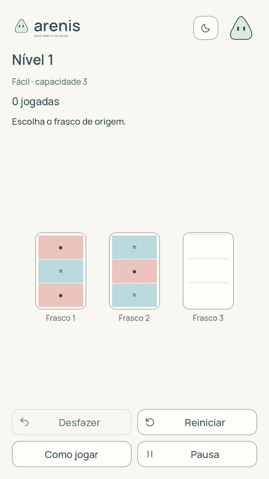
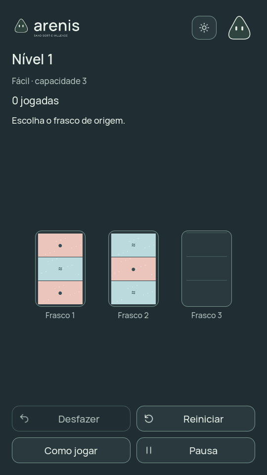
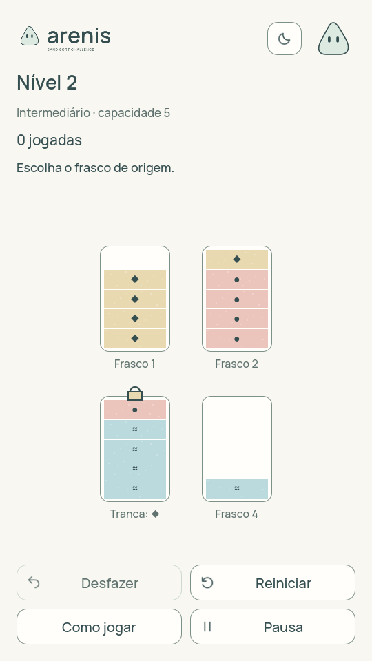
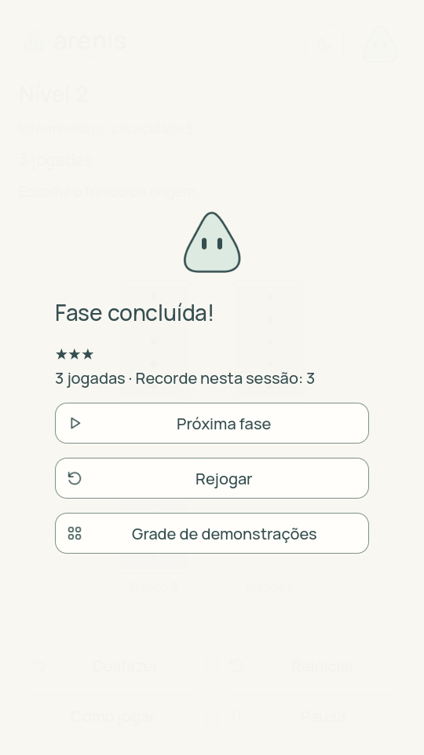

# Relatório da fase 3 — Identidade visual e mascote

Data: 12/11/2026. Estado: **concluída a identidade inicial, após escolha da opção A pelo usuário**.

Modelo indicado para a fase: GPT-6.1 Sol, esforço extra alto.

## Resultado

Finalizada a identidade outline/pastel do Arenis e aplicada ao protótipo Godot. A opção A, um triângulo arredondado com dois olhos, foi escolhida pelo usuário. O mascote permanece sem nome próprio e sem boca, membros ou acessórios.

A entrega contém assinaturas clara/escura, ícone do aplicativo, corpo e mascote completo em SVG, 12 ícones de interface, paleta, tipografia Manrope com licença e camadas de ícone Android. O guia de uso está em `docs/identidade-visual.md`. Os primeiros conceitos ficam preservados em `design/concepts/v1`; o relatório da exploração está em `fase-03-conceitos.md`.

## Integração jogável

O cabeçalho mostra a assinatura e o mascote A. Ao selecionar um frasco, os olhos apontam para a origem; durante o despejo, seguem o arco da areia; ao terminar, olham para o destino. Jogadas inválidas recebem um olhar breve. Em repouso, os olhos mudam lentamente de direção e piscam. A vitória mostra o mascote acima do resultado.

Corpo e olhos são controlados separadamente. O componente visual não lê nem modifica o estado do quebra-cabeça. Há uma API para reduzir movimento, destinada à futura configuração de acessibilidade.

A tipografia, os botões com contorno, as cores da areia e os símbolos já usam a identidade. O botão sol/lua alterna claro e escuro durante a sessão sem perder o tabuleiro ou o histórico de desfazer. O padrão do sistema, o seletor de preferência e a persistência dessa escolha serão concluídos na fase 4.

## Arquivos principais

- `assets/branding/`: assinaturas, mascote, corpo para animação e ícone do projeto.
- `assets/branding/android/`: PNGs 48/72/96/144/192/512 e camadas 108 em SVG, 432 em PNG e VectorDrawable XML.
- `assets/fonts/`: Manrope variável e licença OFL.
- `assets/icons/`: 12 ícones de contorno que recebem a cor do tema.
- `assets/theme/tokens.json`: paleta de referência.
- `scripts/identity.gd`: tema e fonte compartilhados.
- `scripts/mascot.gd`: olhar, piscada, ociosidade e reações.
- `scripts/main.gd`, `scripts/bottle.gd`: aplicação visual e eventos do mascote.
- `tests/identity_test.gd`: verificações do comportamento e da integração.
- `tools/play.ps1`, `tools/check.ps1`: importação automática antes de executar, incluindo um clone sem cache.
- `design/source/export_identity.gd`: exportação raster reproduzível dos originais SVG.

As pastas `design/` e `docs/` usam `.gdignore` para que estudos e capturas não sejam tratados como recursos do aplicativo. Os arquivos de produção ficam em `assets/`.

## Validação

Godot 4.7.2, Windows. **258 verificações passaram**: 85 de regras, 13 de fluxo de interface, 142 de solver/catálogo e 18 novas de identidade. **Seis cenários de CLI** também passaram.

A verificação incluiu corpo claro/escuro, limites do olhar, interpolação, fechamento e reabertura dos olhos, redução de movimento automático, reação de vitória, evento de seleção, retorno inválido, acompanhamento do despejo, chegada ao destino e troca de tema preservando estado/histórico. A suíte completa também passou em uma cópia nova sem cache de importação.

Foram renderizadas e inspecionadas telas reais do Godot: seleção de demonstrações, nível claro, nível escuro, areia escondida, tranca e resultado. Ajustadas a legibilidade das legendas e a tranca, mantendo o pastel no preenchimento e o contraste no contorno.

Os SVGs e XMLs foram analisados e os PNGs conferidos por tamanho e canal alpha. As camadas foreground e monochrome de 432 × 432 mantêm os pixels visíveis dentro da área central correspondente a 66 × 66 da base 108. Os recursos Android seguem a [orientação oficial de ícones adaptativos](https://developer.android.com/develop/ui/compose/system/icon_design_adaptive). Ainda não foram compilados ou conferidos em um launcher Android.

## Limitações e trabalho seguinte

A entrega continua executável pelo Godot no desktop. A exportação, o mapeamento dos recursos Android, a assinatura e a validação do APK pertencem à fase 5.

A campanha permanece com as seis demonstrações. As 150 fases serão produzidas na fase 4 com o solver já entregue. Também ficam para a fase 4: navegação final, progressão, salvamento local, preferências completas, idiomas, áudio e tutoriais interativos. Nuvem e anúncios entram na fase 5.

A linguagem visual inicial está pronta para as próximas telas. A ampliação das cores de jogo deve manter símbolos e contraste; a paleta de apoio não adiciona novos identificadores de cor automaticamente ao catálogo.

## Git e próxima fase

Arquivos no repositório oficial `C:\git-workspace\arenis-mobile-game`. Sem commits ou push nesta entrega; planejamento e implementação ainda estão no diretório de trabalho.

Próxima fase: **4 — Campanha e experiência completa**. Modelo recomendado: **GPT-6.1 Sol, esforço médio** para interface e preferências; **GPT-6.1 Sol, esforço alto** durante produção/validação de fases que envolva o solver.

## Telas reais

