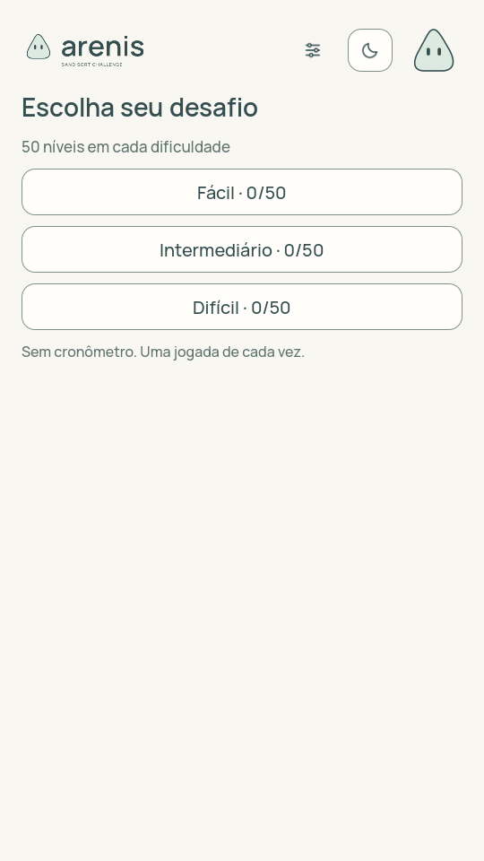
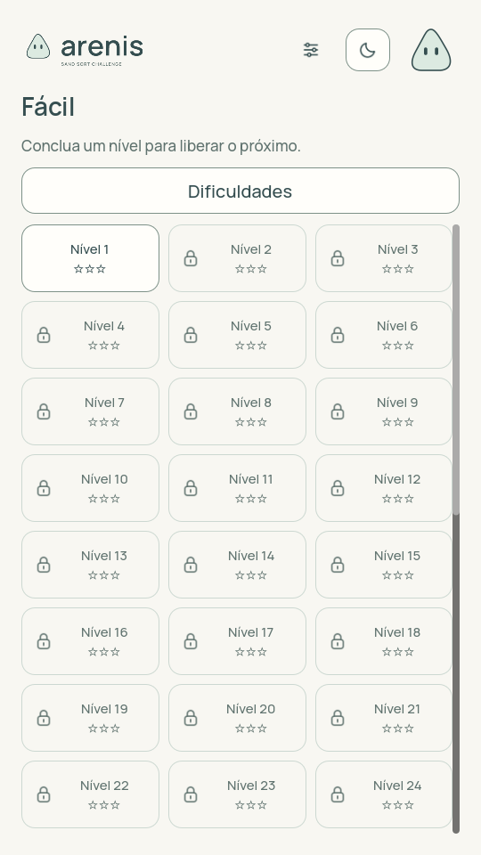
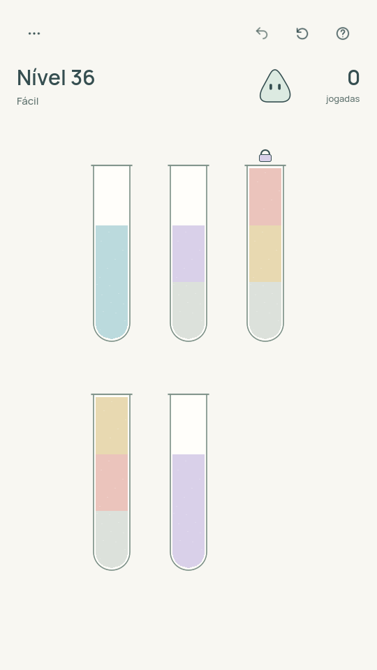

# Fase 4A — Campanha inicial e progresso básico

Data: 12/11/2026. Modelo recomendado nesta etapa: GPT-6.1 Sol, esforço alto.

## Entrega

150 níveis fixos: 50 fáceis, 50 intermediários e 50 difíceis. Todos têm solução reproduzida e mínimo de jogadas comprovado pelo solver Godot, usando as mesmas regras do jogo. Não há geração aleatória durante a partida.

Os tabuleiros foram construídos offline com semente fixa, por movimentos reversos verificáveis. A etapa de autoria não substitui a prova: cada candidato passou pelo solver, e o pacote final foi validado novamente após ordenação e atribuição de IDs. Não há tabuleiros repetidos dentro de uma dificuldade, mesmo desconsiderando permutações das cores e dos tubos, segredos e trancas.

Os nomes seguem Nível 1 até Nível 50 em cada dificuldade. Introdução: níveis 1–10 sem obstáculos, 11–20 com areia escondida, 21–35 com trancas, 36–50 com combinações. Dentro de cada bloco de introdução, a ordenação considera o mínimo; começar uma nova mecânica pode reduzir a quantidade de movimentos. O mínimo não é uma medida completa da dificuldade percebida.

Foi incorporada lavanda (`lilac`) à paleta, ao catálogo, ao schema, ao despejo e ao modo opcional de símbolos, com marca +. A maioria dos níveis tem um tubo vazio de apoio; outros distribuem o espaço entre tubos parcialmente cheios.

| Dificuldade | Capacidade | Níveis | Mínimos | Sem tubo vazio | Com areia escondida | Com tranca |
|---|---:|---:|---:|---:|---:|---:|
| Fácil | 3 | 50 | 3–7 | 13 | 25 | 30 |
| Intermediário | 5 | 50 | 4–11 | 15 | 25 | 30 |
| Difícil | 7 | 50 | 3–11 | 15 | 25 | 30 |

## Aplicativo

O jogo abre uma seleção de três dificuldades, todas disponíveis desde o início. Cada uma possui uma grade de 50 níveis; concluir libera o seguinte e os anteriores permanecem rejogáveis. A próxima fase no resultado permanece na mesma dificuldade.

Estrelas e melhor quantidade de jogadas de conclusões são salvas localmente em `user://progress.cfg`, com ID e revisão do nível. Rejogar não reduz estrelas nem piora o recorde. Registros de outra revisão de tabuleiro não são aplicados automaticamente. Falha ao salvar é comunicada no resultado e permite tentar novamente.

Os tubos se distribuem em até duas linhas nos tabuleiros desta campanha, mantendo a direção visual aprovada. A grade usa três colunas para evitar rolagem horizontal. As demonstrações anteriores continuam nos testes como regressão, separadas da campanha.

## Evidência e verificações

- `data/campaign.json`: pacote final com mínimos.
- `fase-04a-provas.json`: 150 resultados `optimal`, `accepted: true`, modo `validate`, fingerprints e soluções reproduzíveis.
- `fase-04a-niveis.csv`: todos os mínimos, limites de estrelas, cores, tubos e obstáculos.
- `fase-04a-estatisticas.json`: estatísticas por dificuldade.

Passaram **1.697 verificações**: regras 85, interface 13, solver/catálogo 142, identidade 18, layout/configurações 26 e campanha 1.413. Passaram também seis cenários de CLI. Os testes da campanha conferem 150 fingerprints/mínimos e reproduzem todas as soluções até a vitória, além de validar quantidade, numeração, persistência de recordes, revisões e desbloqueio independente por dificuldade.

O pacote passou pelo JSON Schema e pela verificação de unicidade sob permutações de cores e tubos. Foram inspecionadas capturas reais da seleção, grade e um nível combinado. O teste de grade confirma ausência de rolagem horizontal.

## Continuação da fase 4

Esta entrega conclui a autoria matemática inicial e a navegação/progresso básico, não toda a fase 4. Ainda faltam retomada de uma partida em andamento por dificuldade, botão Continuar, salvamento do histórico de desfazer, padrão de tema do sistema e preferências completas, idiomas, áudio e tutorial interativo com destaque. Até a retomada ser implementada, sair de uma tentativa com jogadas exige confirmação de descarte; estrelas e recordes concluídos permanecem salvos.

Os níveis precisam de sessões de jogo para avaliar diversão, ritmo e dificuldade percebida antes da publicação. Os mínimos estão comprovados; essa prova não substitui o balanceamento qualitativo. Os níveis ainda não foram publicados e podem ser revisados nesta etapa, recalculando provas e versões quando necessário.

Nuvem, anúncios e APK continuam na fase 5. O progresso desta entrega é local e guarda resultados concluídos, não o tabuleiro em andamento.

## Git e modelo para a continuação

Entrega no repositório oficial, sem commit ou push. Para a próxima parte da fase 4 (interface, retomada e preferências), a indicação é **GPT-6.1 Sol, esforço médio**. Alterações de autoria ou solver continuam indicando esforço alto.

