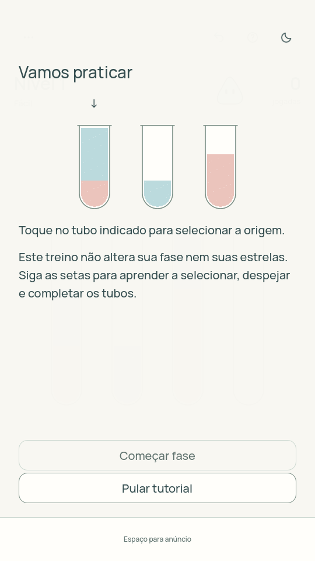
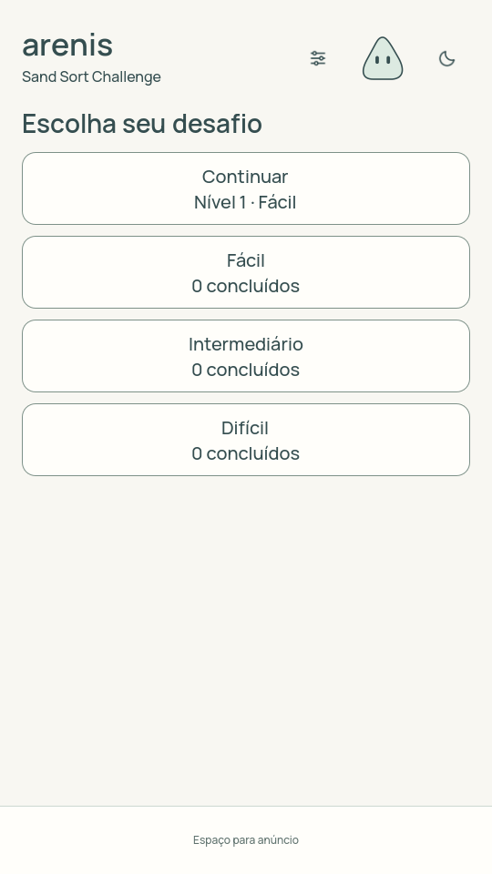
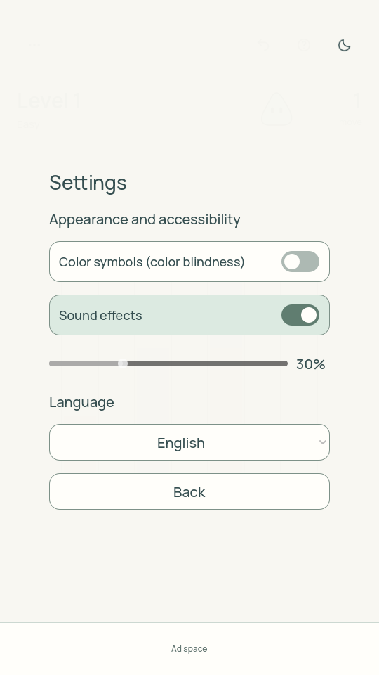
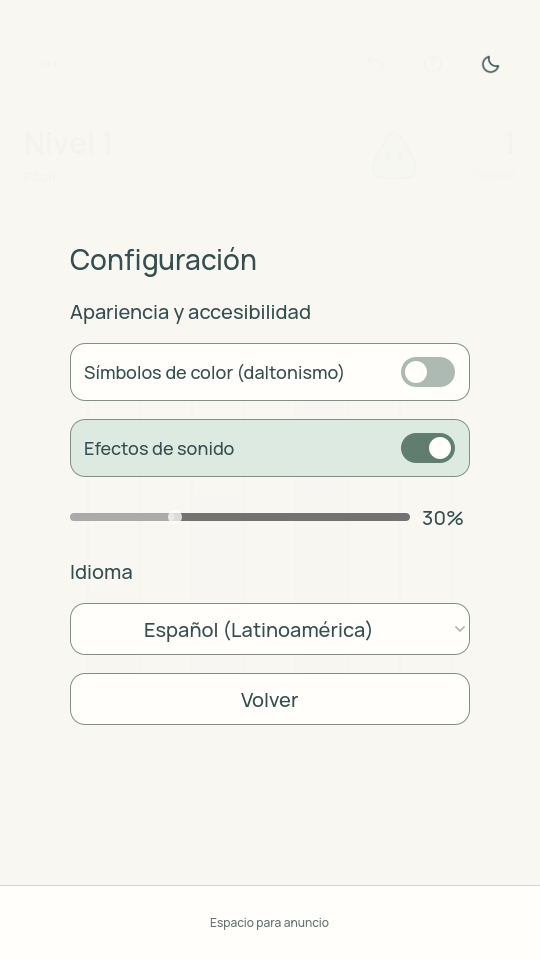

# Fase 4B — Salvamento, idiomas e treino interativo

Data: 12/11/2026. Repositório oficial: `C:\git-workspace\arenis-mobile-game`. Conclusão do escopo local da fase 4 autorizado pelo usuário.

## Resultado

| Item | Comportamento entregue |
|---|---|
| Salvar e retomar | Uma tentativa por dificuldade, incluindo tubos, jogadas, histórico de desfazer, cores descobertas e trancas. |
| Continuar | A tela inicial retoma a tentativa mais recente; a grade permite retomar a tentativa daquela dificuldade. |
| Sair e trocar de nível | Sair para a grade preserva a partida. Substituir uma tentativa com jogadas por outro nível da mesma dificuldade exige confirmação. Uma tentativa ainda sem jogadas pode ser substituída diretamente. |
| Proteção do arquivo | Escrita temporária, backup do último arquivo válido e troca atômica. Leitura do formato anterior de recordes e recuperação pelo backup quando necessário. |
| Idiomas | pt-BR, inglês e es-419, offline, com detecção do sistema e escolha manual em Configurações. |
| Tutorial inicial | Treino interativo em tabuleiro independente, com seleção, dois despejos e objetivo de tubos cheios monocromáticos. Pulável e reabrível em Como jogar → Praticar. |

## Persistência

`Rules` mantém um diário das ações válidas, incluindo desfazer. `Progress` grava o diário com ID, revisão, versão das regras e fingerprint da fase. Na retomada, as ações são reproduzidas no mesmo núcleo, reconstruindo o histórico, o conhecimento acumulado e as trancas. Operações ilegais, versões diferentes ou fingerprints incompatíveis não são restaurados.

O checkpoint acontece logo após a operação lógica e antes da animação. Se o app fechar durante um despejo, ele retoma o resultado completo dessa jogada; não recupera areia em posições intermediárias da animação. Reiniciar zera a tentativa e salva esse novo estado. Desfazer continua somando uma jogada após a retomada.

Uma vitória grava o resultado e remove a tentativa na mesma atualização do arquivo. Isso ocorre antes da animação terminar, mas a apresentação da vitória continua esperando a animação. Estrelas antigas, recordes e resultados arquivados são preservados. Não foi reintroduzida a tela de Resultados anteriores.

O arquivo usa schema local 2, compatível com os resultados anteriores. `config_store.gd` grava em temporário e mantém `.bak`. Se o principal estiver ausente ou não puder ser lido, tenta a cópia de segurança. Recuperação corresponde ao último estado disponível nesse backup; não promete reconstruir dados que nunca foram gravados.

As verificações usam arquivos temporários. Nenhum salvamento pessoal foi apagado, reiniciado ou convertido pelas ferramentas de implementação.

## Localização

Há **105 mensagens por idioma** em `locales/pt_BR.json`, `en.json` e `es_419.json`, cobrindo menus, avisos, níveis, ajuda, treino e obstáculos. O nome Arenis: Sand Sort Challenge permanece em inglês.

A escolha automática mapeia locales ingleses para en, espanhóis para o pacote latino-americano e usa pt-BR como fallback. A escolha manual prevalece e é persistida. O Godot padroniza internamente es_419 como es; o pacote e o conteúdo selecionados continuam sendo latino-americanos.

A mudança de idioma recompõe os controles, mantendo o mesmo objeto de jogo, os movimentos e o histórico. Texto de níveis é formatado como Nível/Level/Nivel mais o número, mantendo os IDs estáveis. Os controles persistentes de tema e anúncio também mudam de idioma. Mensagens de erro vazias não reservam espaço, permitindo acomodar o seletor de idioma.

Na fase 5, a exportação Android precisa incluir os JSONs de dados e idiomas no filtro de arquivos não-resource. Não há download de pacotes durante o jogo.

## Treino inicial

O treino abre no primeiro jogo novo, mesmo se a pessoa começar pelo Difícil. Setas indicam primeiro a origem e depois o destino; entradas incorretas orientam sem penalização. Duas transferências ensinam a movimentação do bloco do topo e a conclusão com tubos cheios de uma única cor.

Esse tabuleiro é independente: não descobre cores, não conta movimentos nem rende estrelas na campanha. O botão Começar fase é liberado ao concluir; Pular tutorial permite continuar imediatamente. A confirmação ou o pulo fica salvo nas preferências. A prática pode ser reaberta pela ajuda sem alterar a partida.

As apresentações específicas de areia escondida, trancas e combinação continuam funcionando e aparecem depois do treino básico quando apropriado.

## Verificação

Godot 4.7.2 em Windows. **3.991 verificações e seis cenários de CLI passaram, sem falhas.** Totais:

| Suíte | Verificações |
|---|---:|
| Regras | 88 |
| Interface | 13 |
| Solver/catálogo | 232 |
| Identidade | 18 |
| Layout/configurações | 24 |
| Campanha | 2.731 |
| Polimento | 37 |
| Refinamento | 46 |
| Progresso/tema | 29 |
| Final de áudio | 13 |
| Paletas | 37 |
| Obstáculos | 42 |
| Partidas em andamento | 20 |
| Idiomas | 649 |
| Treino inicial | 12 |

Cobertura adicional: diário com desfazer e descobertas; trancas reconstituídas; independência entre dificuldades; escolha da tentativa mais recente; rejeição de dados incompatíveis; recuperação de backup; checkpoint antes do fim da animação; confirmação de substituição; vitória e remoção da tentativa em uma gravação; chaves e marcadores de todas as traduções; detecção/fallback; escolha manual; alteração de idioma sem mudar a partida; prática correta, erros de toque, pulo e repetição sem efeito na campanha.

O renderer Compatibility foi usado para conferir português, inglês e espanhol: ajuda, configurações, treino, nível, Continuar e obstáculo no escuro. O utilitário fechou a cena, abriu outra lendo o arquivo e confirmou `RESTORED SAME BOARD: true`. Não houve alteração nos tabuleiros, mínimos, paletas ou áudio aprovados.

## Continuidade

A fase 4 está concluída no escopo local combinado. A fase 5 começa com APK para teste em aparelho e integrações Android: anúncios reais e conexão/sincronização opcional com Google Play Games. Ainda não há validação em aparelho nem anúncio real nesta entrega.

Sem commit ou push. Modelo previsto no roteiro para a próxima fase: **GPT-6.1 Sol, raciocínio Alto**. Publicação permanece uma etapa separada.

