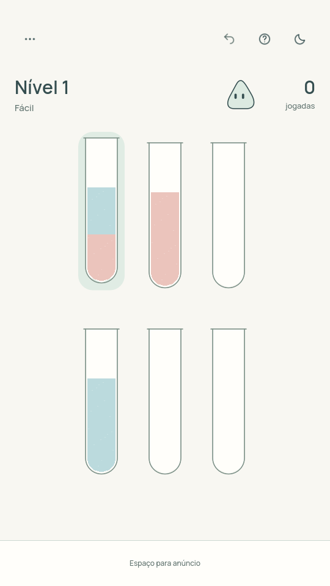
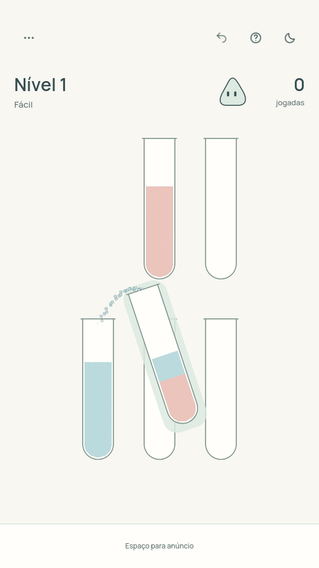
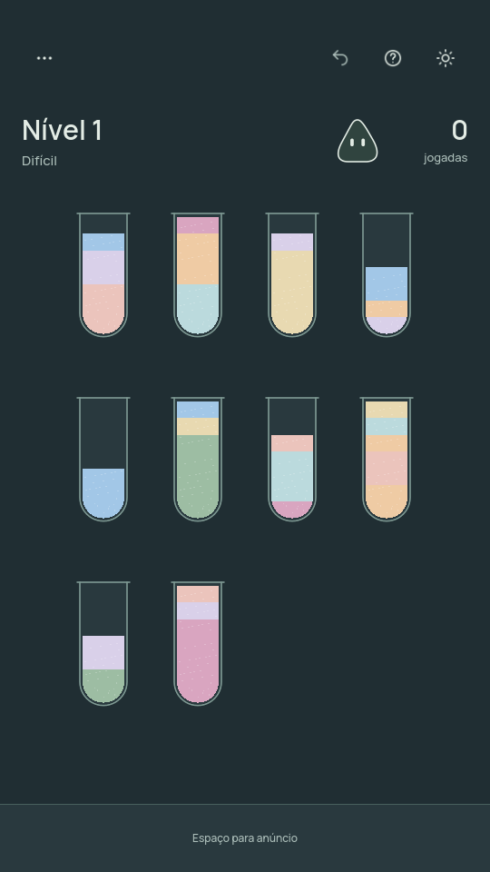

# Revisão de seleção, animações e desafio

Data: 12/11/2026. Continuação da fase 4. Repositório oficial: `C:\git-workspace\arenis-mobile-game`.

## Pedidos e resultado

| Pedido | Entrega |
|---|---|
| Não destacar todos os destinos nem engrossar linhas | Somente a origem recebe fundo suave e elevação animada de 8 unidades. Contorno de 1,4 unidade em repouso e selecionado. |
| Desfazer parecido com reiniciar | Reiniciar fica apenas no menu da fase, com confirmação. A barra mantém menu, desfazer, ajuda e o controle global de tema. |
| Remover música | Player, controles, preferências ativas, geração e WAV ambiente removidos. Preferências antigas de música são ignoradas e descartadas ao salvar um ajuste de áudio. |
| Som de areia mais leve | Substituído o chiado agudo por ruído com duas etapas de filtragem passa-baixas e envelopes suaves. Efeitos continuam com volume configurável, 30% por padrão. |
| Conferir tamanho do banner Google | A reserva antiga de 36 unidades Godot não correspondia a um tamanho validado em dp. A prévia usa agora uma referência de 50 dp; detalhes e limite abaixo. |
| Entendi sempre visível | Título e ação de fechamento ficam fora da área de rolagem. Apenas o texto de ajuda rola; o botão permanece acima do anúncio. |
| Despejo vertical estranho | O tubo se desloca para uma posição acima e ao lado do destino, inclina e despeja para baixo; depois retorna à grade. Mesmo comportamento ao desfazer. |
| Animação pouco perceptível | Movimento e inclinação do tubo, corrente mais densa e grãos maiores. O início do preenchimento acompanha a chegada dos primeiros grãos. |
| Intermediário/Difícil pouco desafiadores | 100 novos tabuleiros: Intermediário com 7–8 tubos e Difícil com 10–12, conforme quantidade aprovada. Mais cores e misturas desde o primeiro nível. |
| Tema desalinhado | Cabeçalhos e barra de ações usam a mesma altura de 80 unidades; os centros dos controles compartilham a mesma linha, inclusive tema. Continua acessível em menus. |

## Campanha e progresso

São mantidos os 50 tabuleiros Fáceis. O pacote de campanha passa à versão 2, e os 100 tabuleiros substituídos passam à revisão 2, conservando IDs e numeração. As regras continuam na versão 2: qualquer destino destrancado com espaço recebe areia; cada desfazer válido soma uma jogada.

| Dificuldade | Níveis | Tubos | Cores por nível | Mínimos comprovados |
|---|---:|---:|---:|---:|
| Fácil | 50 | 3–6 | 2–4 | 3–7 |
| Intermediário | 50 | 7–8 | 5–6 | 12–18 |
| Difícil | 50 | 10–12 | 8–10 | 20–30 |

Areia escondida, trancas e suas combinações continuam presentes. A variedade inclui espaço livre distribuído, sem depender sempre de tubos vazios. Os tabuleiros são fixos em execução. O aumento do mínimo mede esforço da solução ótima; a dificuldade percebida ainda precisa do teste humano.

O acesso a níveis previamente liberados é preservado. Estrelas e recordes só aparecem se pertencem à revisão atual do tabuleiro. Ao salvar uma conclusão na nova revisão, o resultado anterior é arquivado por ID e revisão em `archived_levels`, sem misturar pontuações de fases diferentes. Não há exclusão do progresso anterior.

Evidências: [150 soluções atuais e fingerprints](revisao-desafio-provas.json), [mínimos e limites das estrelas](revisao-desafio-niveis.csv) e [sementes de autoria](revisao-desafio-autoria.json). Os relatórios anteriores são mantidos como histórico.

O processo de autoria substituiu candidatos cuja busca atingiu limite por outros candidatos, exigindo prova exata de cada substituto. A campanha final passou novamente pelo validador sem `--solve`, com `accepted: true`, e teve suas 150 soluções reproduzidas nos testes. Não se inferiu um mínimo a partir de uma busca interrompida.

## Dimensões do banner

Segundo a [documentação Google para banners fixos](https://developers.google.com/admob/android/banner/fixed-size), o banner pequeno mede **320 × 50 dp**, e o contêiner precisa comportá-lo. Para ocupar a largura disponível, a integração pode usar um [banner adaptativo ancorado](https://developers.google.com/admob/android/next-gen/banner), recebendo a altura calculada pelo SDK.

O protótipo usa uma tela de referência de 540 × 960 unidades Godot. A faixa de 75 unidades simula 50 dp numa referência de 360 dp de largura. Essa é uma **simulação visual**, não uma declaração de conformidade em aparelhos Android: unidades Godot, pixels físicos e dp são medidas diferentes.

`apply_banner_measurement(screen_width_px, height_px)` recebe medidas em pixels da futura integração nativa, converte-as para o espaço Godot e atualiza as margens da área jogável. Ainda não há SDK conectado, anúncio real ou validação de insets em aparelho. A altura definitiva será a do formato solicitado ao SDK, sem comprimir ou recortar a publicidade.

## Animação, áudio e layout

O tubo tem inclinação de aproximadamente 18 graus, aproximação, despejo e retorno. A escolha do lado e os limites do deslocamento impedem que o corpo seja cortado nas bordas. A corrente usa 90 emissões escalonadas, com entrada e saída suaves, e os primeiros grãos chegam antes de o destino começar a encher. A vitória continua aguardando o fim da animação. Durante o movimento, comandos do tabuleiro ficam bloqueados.

A grade usa quatro colunas para os tabuleiros maiores e até três linhas; a altura dos tubos é calculada pelo espaço acima do banner. A largura mínima da área de toque continua em 88 unidades. As dez cores têm símbolos distintos quando a opção de daltonismo está ativa; cores ocultas não são reveladas por essa opção.

O novo `sand.wav` tem 2,1 segundos, PCM mono, 22.050 Hz e 16 bits. Pico normalizado aproximado de 0,0433 e RMS de 0,0118, sem clipping. A filtragem reduz os agudos do efeito anterior. A reprodução e o volume foram verificados no Godot; a aprovação subjetiva do som fica para o teste do usuário.

## Verificação e continuidade

Godot 4.7.2 em Windows. **3.182 verificações e seis cenários de CLI passaram, sem falhas.** Totais: regras 88, interface 13, solver/catálogo 232, identidade 18, layout/configurações 24, campanha 2.731, polimento 37 e refinamento 39.

Cobertura adicional: ausência de destaque nos destinos, seleção suave da origem, reinício somente no menu, alinhamento no início e na fase, botão fixo antes/depois de rolar a ajuda, despejos verticais nos dois sentidos, retorno do tubo à grade, áudio sem música, conversão da medida nativa do banner, layouts de 7/8/10/11/12 tubos, preservação de acesso e arquivamento/recarregamento de resultados de outra revisão.

Capturas reais do renderer Compatibility foram inspecionadas: inicial, seleção, despejo vertical, desfazer, menu, ajuda no início/fim, configurações claras/escuras e os primeiros/últimos níveis das duas dificuldades maiores. Os testes usam preferências e progresso temporários.

Sem commit ou push nesta revisão. A fase 4 segue com retomada de tentativas, idiomas e demais pendências do roteiro. SDKs de monetização e APK em aparelho permanecem para a etapa Android. Modelo indicado para continuar: **GPT-6.1 Sol, raciocínio Alto**.

