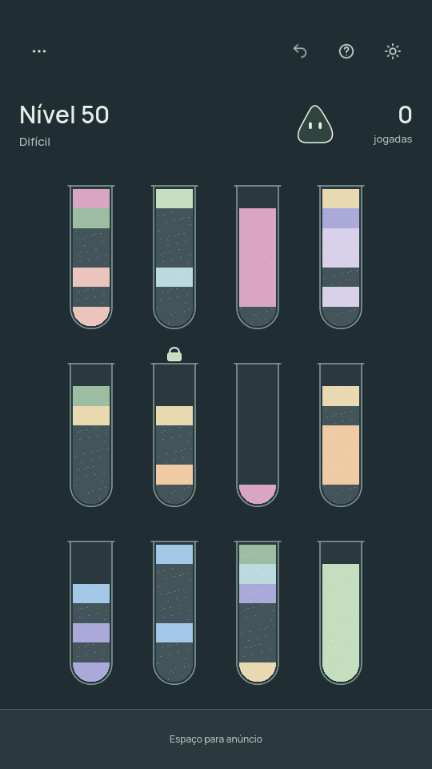
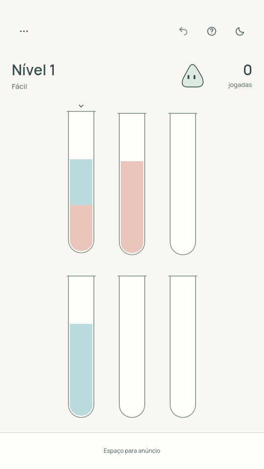

# Revisão de espaço, seleção e efeito de areia

Data: 12/11/2026. Continuação da fase 4, no repositório oficial `C:\git-workspace\arenis-mobile-game`.

## Entrega

- **Tubos maiores:** removida a linha vazia reservada às mensagens e reduzidas as margens de cada célula. As três fileiras aproveitam o espaço até a margem do banner. Na referência 540 × 960, o corpo dos tubos passa de aproximadamente 135 para 178 unidades, cerca de 32% maior. A altura continua adaptável; a área de toque mantém largura mínima de 88 unidades.
- **Seleção discreta:** removida a cápsula de fundo. Apenas a origem sobe 4 unidades e recebe um pequeno marcador acima da boca. O contorno continua com a mesma espessura, e os destinos não são destacados.
- **Som natural:** conforme a preferência do usuário, o ruído sintetizado foi substituído por uma gravação real de areia, com tratamento leve, entrada/saída suaves e volume discreto.

As mensagens temporárias usam a margem acima do banner, sem alterar a altura da grade quando aparecem. As bocas dos tubos, os pontos das animações e o cálculo da altura compartilham as mesmas medidas de margem. Despejar, desfazer e o tempo de espera da vitória mantêm o comportamento anterior.

## Fonte e processamento do áudio

Gravação **sand pour on sand FF662.aif**, de **martinimeniscus**, no [Freesound](https://freesound.org/people/martinimeniscus/sounds/199332/), cuja página declara licença **CC0 1.0**. A prévia pública de alta qualidade foi preservada em `tools/audio_sources/`, junto com autoria, URL, licença e SHA-256. A pasta é excluída da importação Godot por `.gdignore`.

`tools/prepare_sand_audio.py` extrai 6,4–8,5 segundos da fonte, converte para mono/22.050 Hz/16 bits, remove graves abaixo de 180 Hz e reduz agudos acima de 6 kHz, ajusta o ganho e aplica fades. O resultado tem 2,1 segundos, pico normalizado aproximado de **0,0371** e RMS de **0,00295**, sem clipping. A amplitude média corresponde a cerca de um quarto da versão anterior; isso não equivale a uma garantia de percepção subjetiva de volume.

O jogo continua usando o volume de efeitos configurado pelo usuário. O áudio foi importado e reproduzido pelo Godot nos testes; o timbre fica disponível para avaliação no jogo. O gerador de sons sintetizados passa a produzir apenas os efeitos de toque e conclusão.

## Verificação

**3.189 verificações e seis cenários de CLI passaram, sem falhas.** Totais: regras 88, interface 13, solver/catálogo 232, identidade 18, layout/configurações 24, campanha 2.731, polimento 37 e refinamento 46.

As verificações adicionais conferem altura mínima de 170 unidades nos três casos de três fileiras, espaço entre corpos de no máximo 44,5 unidades e ausência de reserva vertical para mensagens vazias. A regressão também cobre despejo vertical nos dois sentidos, retorno à grade, ajuda com ação fixa, banner e reprodução dos efeitos.

As telas foram renderizadas no Godot Compatibility e inspecionadas, incluindo seleção, despejo vertical, 10 e 12 tubos. As capturas anteriores foram preservadas; as novas ficam em `imagens/espacamento/` e podem ser reproduzidas por `tests/capture_spacing.gd`.

Tabuleiros, mínimos, estrelas e regras não foram modificados. As 150 soluções atuais continuam passando na regressão. Sem commit ou push. Próximos itens da fase 4 seguem no roteiro; modelo indicado: **GPT-6.1 Sol, raciocínio Alto**.

