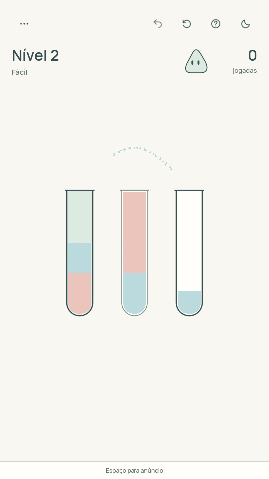
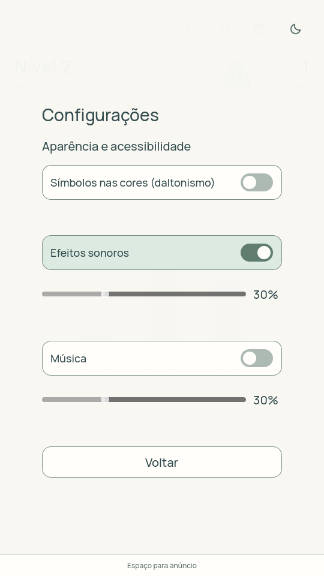
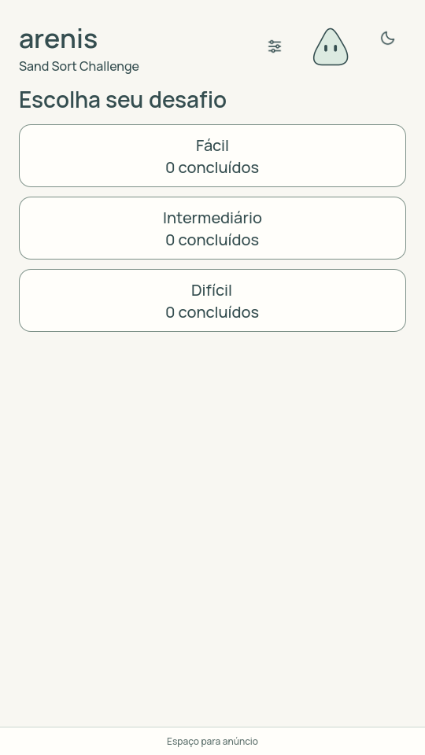

# Revisão de interação, transições e áudio

Data: 12/11/2026. Continuação da fase 4 após os testes do usuário.

## Pedidos e entrega

| Pedido | Alteração |
|---|---|
| Entrada de areia brusca | Origem esvazia e destino enche por alturas fracionárias, com suavização e assentamento final. |
| Aguardar a última animação | A vitória só é apresentada depois do preenchimento, saída dos grãos e pequena pausa de assentamento; comandos ficam bloqueados durante a transferência. |
| Retirar texto sobre cronômetro | Removido da tela inicial. |
| Transição de tema | Crossfade de cerca de 300 ms com captura da apresentação anterior no renderer gráfico. |
| Tema em todas as telas | Controle global sol/lua sobre telas e menus, sem fechar a tela nem reconstruir o tabuleiro. Escolha salva. Removida a ação de tema em Configurações. |
| Centro dos botões de nível | Cadeados desenhados como elementos independentes do texto. |
| Blocos não despejando com espaço | Qualquer tubo destrancado com espaço recebe areia, independentemente da cor no topo. O máximo que couber do bloco é transferido, inclusive parcialmente. |
| Trocar origem sem desselecionar | Pressionar outro tubo ocupado/destrancado por cerca de 400 ms troca a origem sem despejar. Um toque em outro tubo cheio também o seleciona como origem. |
| Ajuda simples e botão ambíguo | Explicações de seleção, despejo máximo/parcial, troca de origem, objetivo e estrelas, mais instrução da mecânica do nível; fechamento por Entendi. |
| Sons e controladores | Sons originais de areia, toque e conclusão; música ambiente opcional; liga/desliga e volumes separados, salvos localmente. |
| Toggle pequeno | Arte 56 × 32 e área de toque vertical de pelo menos 58 unidades. |
| Textos centralizados nos menus | Botões de ação mantêm o centro do texto, com ícones independentes. Rótulos de ajustes seguem o alinhamento de controles de configuração. |
| Remover quantidade de níveis no início | Retirada a frase de 50 níveis e o denominador /50 dos cartões iniciais. |
| Subtítulo ilegível | Assinatura do cabeçalho composta em texto, com Sand Sort Challenge em Manrope 16. |
| Animação de desfazer | Corrente invertida e preenchimento gradual, restaurando areia e trancas e mantendo descobertas. Cada desfazer válido soma uma jogada. |
| Banner inferior | Faixa global de 36 unidades, largura total, com espaço reservado acima para não encobrir tubos ou botões. |
| Navegação suave | Fades de abertura de página/menu e fechamento de menus, com controles da camada que sai desativados. |

## Despejo relatado pelo usuário

O usuário esclareceu o caso: na dificuldade Fácil, formou duas porções vermelhas e tentou despejá-las em um tubo com uma porção azul. A regra anterior impedia destinos com outra cor. A orientação atual remove essa restrição: duas porções vermelhas cabem sobre uma azul em um tubo de capacidade 3. Há regressão desse exemplo tanto no núcleo quanto na interface animada.

Somente o bloco contínuo da cor no topo da origem é transferido, no máximo até preencher o destino. As trancas continuam impedindo envio e recebimento. A ajuda foi atualizada para explicar o despejo sobre outra cor, a transferência parcial e o gesto de pressionar para trocar a origem.

Também foi aprovado que desfazer conte como movimento: despejo + desfazer somam duas jogadas. A areia e as trancas retornam ao estado anterior, mas o contador cresce. Desfazer sem histórico não conta; reiniciar zera a tentativa. A pontuação inclui todos os desfazeres válidos. Recordes e estrelas anteriores são preservados.

## Mínimos e versão das regras

As alterações foram registradas como `rules_version: 2`, no núcleo, nos pacotes de dados e no schema. Os 150 níveis e as seis demonstrações foram recalculados e depois validados sem `--solve`. Todos continuam solucionáveis; os mínimos permaneceram iguais aos anteriores nesses tabuleiros. IDs, ordem e revisões dos tabuleiros foram mantidos.

A busca exata agora usa A* com limite inferior baseado em blocos contínuos e redução de simetrias que preserva as exigências de trancas ainda fechadas. O cálculo foi comparado a uma BFS posicional independente em famílias pequenas, espaço distribuído, permutações de tubos e desbloqueio durante a partida. Desfazer retorna a um estado anterior com custo positivo e não melhora o mínimo; por isso a busca ótima continua usando apenas despejos.

Evidências atuais: [150 soluções e fingerprints](revisao-interacao-provas.json), [mínimos e limites de estrelas](revisao-interacao-niveis.csv) e [seis demonstrações](revisao-interacao-prototipo.json). Os relatórios de fases anteriores permanecem como histórico das regras 1.

## Implementação

- `scripts/main.gd`: transferência visual compartilhada entre despejo e desfazer, espera da vitória, seleção direta, camada global de tema/banner, menus com scroll, transições e ajustes de áudio.
- `scripts/bottle.gd`: preenchimento fracionário e altura adaptada a duas linhas de tubos.
- `scripts/stream.gd`: entrada e saída suave dos grãos.
- `scripts/audio.gd`: players, música em loop e volumes independentes.
- `scripts/preferences.gd`: persistência de efeitos, música, volumes e escolha de tema, preservando a opção de símbolos.
- `assets/audio/`: quatro WAVs originais, gerados de modo determinístico por `tools/generate_audio.py`.
- `assets/icons/toggle-on.svg`, `toggle-off.svg`: gráficos maiores dos toggles.
- `scripts/rules.gd`, `solver.gd`, `progress.gd`: legalidade atual, desfazer com custo, mínimos exatos e identificação da versão das regras em novos resultados salvos.

O visual da origem preserva as cores ainda ocultas até terminar a animação; o desfazer mantém as descobertas, como definido nas regras. A representação não muda a aplicação determinística da jogada no núcleo.

O tema segue o aparelho na abertura quando ainda não há escolha manual. A escolha do sol/lua passa a ser persistida. Em testes headless, o crossfade usa uma superfície simples em lugar da captura de viewport indisponível nesse renderer.

Os efeitos são ligados em 30% por padrão; música desligada, volume configurado em 30%. Som de areia acompanha ida e volta; sons e música podem ser ligados/desligados e ajustados individualmente. Os sons foram sintetizados para o projeto, sem gravações ou músicas comerciais. O loop ambiente é contínuo, com 16 segundos.

## Verificação

Godot 4.7.2 em Windows. Passaram **1.827 verificações e seis cenários de CLI**, sem falhas. Totais por suíte: regras 88, interface 13, solver/catálogo 232, identidade 18, layout/configurações 26, campanha 1.413 e polimento 37. A suíte principal é executada por `tools/check.ps1`.

Cobertura nova: blocos inteiros/parciais sobre qualquer cor, exemplo vermelho sobre azul, desfazer afetando estrelas, gesto de pressionar sem despejo acidental, destino enchendo aos poucos, origem esvaziando, retorno animado, restauração de areia e trancas com contador crescente, cor escondida sem revelação antecipada, resultado esperando os grãos, preservação de menu/tabuleiro ao alternar tema, controle global dentro do viewport, áudio em execução e preferências recarregadas, toggles maiores, volumes independentes, ajuda expandida, centro dos botões e layout de duas linhas acima do banner.

Os WAVs foram conferidos por formato e amostras: PCM mono, 22.050 Hz, 16 bits, sem clipping. A reprodução foi executada pelo Godot; a avaliação subjetiva do timbre e volume fica disponível no teste do usuário. Testes e capturas usam preferências temporárias, sem sobrescrever as configurações pessoais.

As telas foram renderizadas e inspecionadas em modo gráfico, incluindo o preenchimento em andamento, inicial, grade, ajuda, configurações claras/escuras e seis tubos. As 150 soluções e seus fingerprints das regras 2 passam na regressão da campanha.

## Limites e continuidade

A faixa inferior é um **espaço reservado**, identificado como tal. Ainda não foi integrado SDK ou anúncio real; o tamanho do formato real será configurado na etapa de monetização Android. Não há recompensa vinculada ao banner.

Retomada de tentativas, idiomas e os demais itens pendentes da fase 4 continuam no roteiro. Ainda não há APK validado em aparelho. Alterações locais em `C:\git-workspace\arenis-mobile-game`, sem commit ou push nesta revisão. Para continuar os itens da fase 4: GPT-6.1 Sol, raciocínio Alto; esta revisão não exige troca de modelo.

