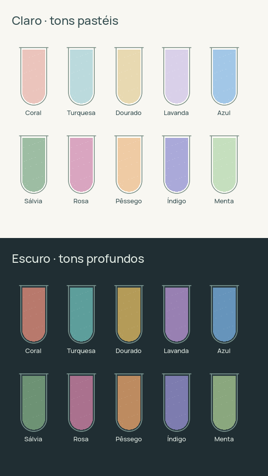
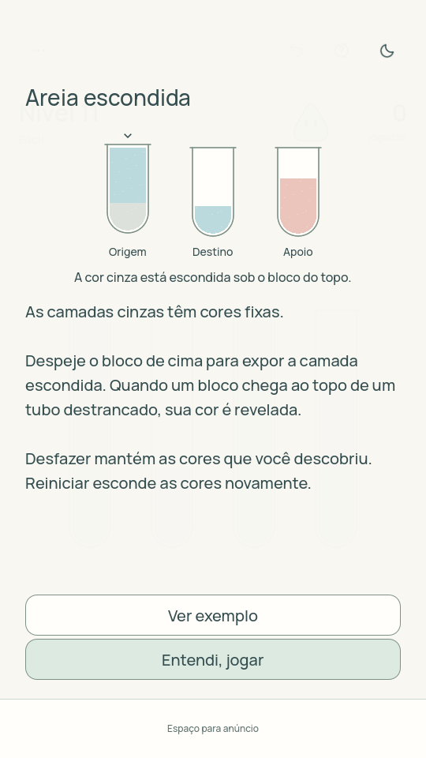
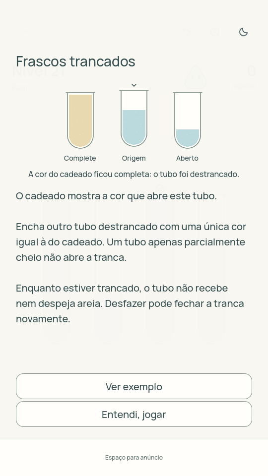
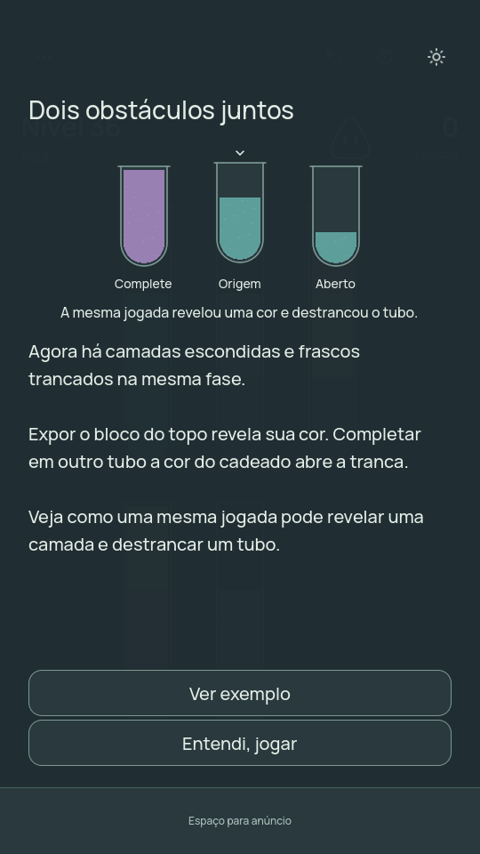

# Revisão de paleta e apresentação dos obstáculos

Data: 12/11/2026. Continuação da fase 4 em `C:\git-workspace\arenis-mobile-game`.

## Entrega

- **Resultados anteriores:** removidos botão, tela e a montagem desses resultados para a interface. Os registros antigos e os arquivos salvos foram preservados. A liberação e as estrelas atuais continuam considerando apenas o tabuleiro atual.
- **Tema escuro:** paleta própria de areia com tons mais profundos e menos luminosos. As dez famílias de cor permanecem reconhecíveis, e a paleta clara foi preservada. A mudança inclui enchimento, grãos do despejo, cadeados e exemplos dos obstáculos.
- **Novos obstáculos:** areia escondida, frascos trancados e combinação receberam apresentações específicas. A ajuda geral deixou de ser a única explicação quando essas mecânicas aparecem.

## Apresentação das mecânicas

Cada apresentação contém título próprio, três tubos de demonstração, animação de antes/depois, legenda do resultado, explicação curta e ações fixas **Ver exemplo** e **Entendi, jogar**. O exemplo toca uma vez automaticamente e pode ser repetido.

Areia escondida demonstra o bloco superior saindo e a cor encoberta sendo revelada. O texto explica que desfazer preserva descobertas e reiniciar esconde novamente. Trancas demonstram completar a cor do cadeado em outro tubo e o desbloqueio resultante; o texto esclarece que o tubo trancado não envia nem recebe areia e que estar parcialmente cheio não basta. A combinação mostra uma jogada que revela uma camada e abre uma tranca.

Os exemplos usam as mesmas regras do núcleo, a capacidade da dificuldade atual e, quando existente, a cor pública do cadeado da fase. O estado é independente: nenhuma ação ou descoberta da demonstração é aplicada ao tabuleiro real, e não há sugestão de solução da fase.

A primeira ocorrência é detectada pelos obstáculos presentes, sem depender dos números dos níveis. A confirmação é guardada por dificuldade nas preferências locais; assim, começar pelo Difícil também apresenta a mecânica. Confirmar a combinação cobre as duas mecânicas individuais. Fechar sem confirmar não marca como visto. Depois da confirmação, a apresentação não volta a abrir ao rejogar fases com a mesma mecânica naquela dificuldade.

## Paleta e leitura

O escuro usa coral queimado, turquesa fechado, dourado fosco e variações mais profundas das demais famílias. Os valores completos estão no [guia visual](../identidade-visual.md). A luminosidade relativa de cada cor escura fica abaixo de 70% da equivalente clara. Todas mantêm contraste de pelo menos 3:1 com o fundo do tabuleiro; os símbolos opcionais mantêm pelo menos 4,5:1 nas duas paletas.

Trocar o tema durante um despejo ou desfazer também troca a cor da corrente, sem alterar a jogada. Partículas do tema escuro recebem menos brilho. Camadas escondidas continuam neutras.

## Verificação

Passaram **3.310 verificações e seis cenários de CLI**, sem falhas. Totais: regras 88, interface 13, solver/catálogo 232, identidade 18, layout/configurações 24, campanha 2.731, polimento 37, refinamento 46, progresso/tema 29, final de áudio 13, paletas 37 e apresentações de mecânica 42.

As novas suítes verificam luminosidade e contraste das dez cores, símbolos, tema durante despejo/desfazer, custo de desfazer preservado, apresentações de cada obstáculo, capacidades das dificuldades, demonstração de revelação/desbloqueio, ausência de alterações na fase real, confirmação e recarga das preferências, separação entre dificuldades e combinação apresentada diretamente no Difícil.

Foram renderizadas e inspecionadas a grade sem Resultados anteriores, a comparação das duas paletas, o nível em claro/escuro, símbolos e as três apresentações antes/depois, incluindo combinação no escuro. As capturas usam dados temporários e não alteram resultados ou preferências pessoais.

As verificações também reproduziram uma chamada de ajuste de layout adiada até depois da troca de tela; referências já destruídas são agora ignoradas antes do ajuste.

## Continuidade

Não foram alterados tabuleiros, mínimos, som ou regras de jogada. Os relatórios anteriores permanecem como histórico, mesmo quando mostram a tela removida. O tutorial básico interativo completo, a retomada de partidas e os idiomas seguem como pendências da fase 4. Alterações locais, sem commit ou push. Modelo indicado para continuar: **GPT-6.1 Sol, raciocínio Alto**.

