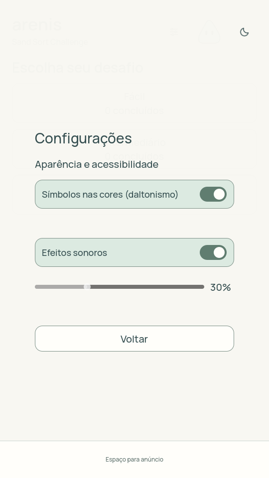
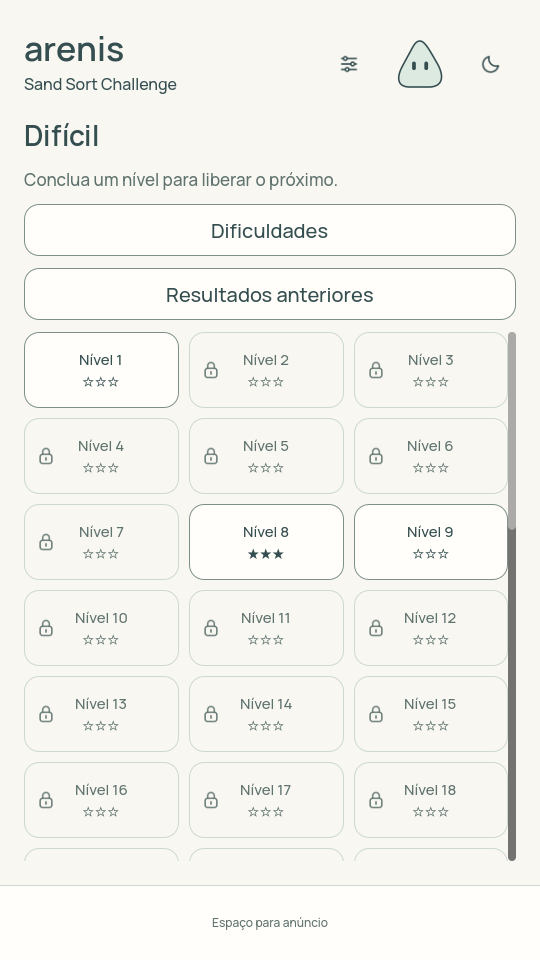
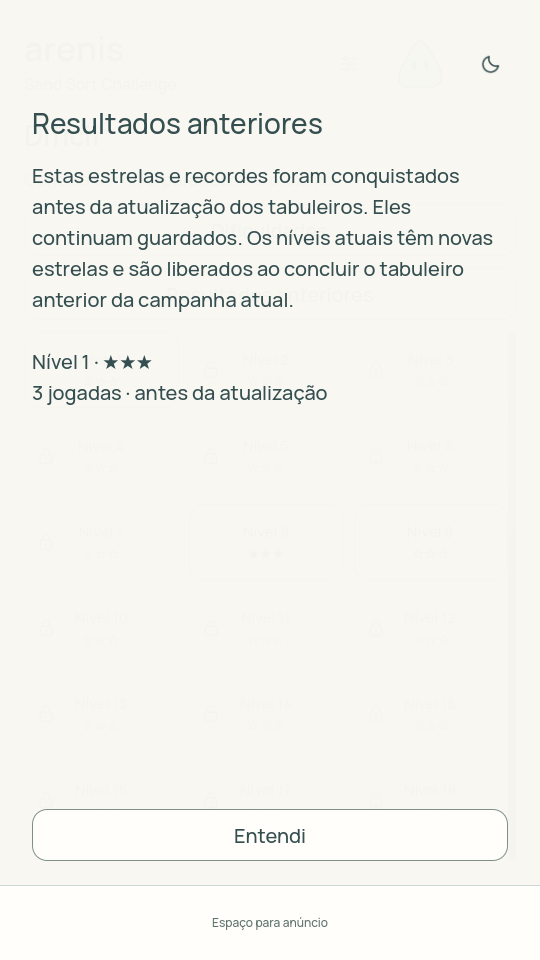

# Revisão de progresso, hover e áudio

Data: 12/11/2026. Continuação da fase 4. Repositório oficial: `C:\git-workspace\arenis-mobile-game`.

## Diagnóstico do progresso

O arquivo de progresso foi lido sem alterações e copiado para uma reprodução temporária. Ele contém resultados da revisão antiga dos tabuleiros Intermediários/Difíceis, além de resultados atuais. A grade já separava as estrelas por revisão, mas o desbloqueio aceitava conclusões de qualquer revisão. Isso explicava o Nível 2 Intermediário acessível sem conclusão do Nível 1 atual.

As estrelas antigas não haviam sido apagadas: estavam registradas para os tabuleiros substituídos. O resultado atual do Nível 8 Difícil, com três estrelas, também estava salvo corretamente. Não foi encontrada falha de escrita nesse caso relatado; havia uma inconsistência entre a apresentação das estrelas e a liberação dos níveis.

## Correções

- **Liberação:** a próxima fase exige conclusão do tabuleiro anterior na revisão atual. Resultados antigos não liberam fases novas. Um nível já concluído na revisão atual permanece rejogável, conservando suas estrelas.
- **Resultados anteriores:** a grade de cada dificuldade oferece essa ação quando existem resultados históricos. O painel mostra estrelas e recordes conquistados antes da atualização, separados da campanha atual e com botão de fechamento fixo.
- **Conclusão:** a tela de resultado exige vitória efetiva e animação encerrada antes de salvar, evitando registrar uma partida ainda não concluída.
- **Toggles:** cores e fundos explícitos para `hover_pressed`, inclusive no tipo `CheckButton`, corrigem o texto branco sobre fundo claro. A correção cobre ambos os temas.
- **Áudio:** a gravação anterior de areia sobre areia foi substituída por uma base de ampulheta pequena e uma camada de areia sobre vidro, buscando o fio de areia fina dentro do frasco.

Nenhum arquivo pessoal de progresso ou preferências foi alterado pelas ferramentas de implementação ou pelos testes. Não houve exclusão, reinicialização ou transferência indevida de estrelas entre revisões. O histórico lê tanto resultados antigos ainda no registro principal quanto resultados já arquivados.

## Áudio e origem

As duas gravações são disponibilizadas em CC0: [ampulheta de el_boss](https://freesound.org/people/el_boss/sounds/625655/) e [areia sobre vidro de martinimeniscus](https://freesound.org/people/martinimeniscus/sounds/199361/). As prévias públicas usadas, os hashes e as etapas de tratamento estão documentados em `tools/audio_sources/README.md`.

A base da ampulheta recebe filtragem para remover graves e manter a textura fina; a camada de vidro usa ganho baixo e faixa de frequência limitada. A mistura tem 2,1 segundos, mono, 22.050 Hz e 16 bits. Pico normalizado aproximado de 0,0162 e RMS de 0,00154, sem clipping. A parada do player também usa fade de 180 ms. Não há música.

O processamento e a reprodução foram verificados no Godot. A aprovação subjetiva do timbre permanece para o teste do usuário; o arquivo pode ser ouvido separadamente em `assets/audio/sand.wav`.

## Verificação

Passaram **3.219 verificações e seis cenários de CLI**, sem falhas. Totais: regras 88, interface 13, solver/catálogo 232, identidade 18, layout/configurações 24, campanha 2.731, polimento 37, refinamento 46 e progresso/tema 30.

A nova suíte reproduz a divergência entre revisões e testa: bloqueio do Nível 2 Intermediário; estrelas atuais preservadas no Difícil; histórico de cada dificuldade; bloqueio de resultados sem vitória; contraste mínimo 4,5:1 nos estados normal, hover, pressionado, hover ativo e desativado dos dois temas; conclusão pela última transferência animada em Intermediário/Difícil; gravação, recarga do arquivo e exibição das estrelas após reabrir o app.

Na reprodução usando a cópia do salvamento relatado: Nível 2 Intermediário bloqueado, três estrelas atuais do Nível 8 Difícil preservadas e resultados anteriores disponíveis para um nível Intermediário e sete Difíceis. A reprodução não escreveu nesse arquivo.

O renderer Compatibility foi usado para inspecionar o toggle ativo sob hover em claro/escuro, a grade atual e o histórico. Em ambos os temas o botão estava efetivamente no modo de desenho `hover_pressed`, com texto contrastante. Os registros de teste também revelaram um fragmento de preenchimento menor que um pixel que podia produzir um polígono degenerado; a apresentação agora ignora fragmentos abaixo de 0,08 unidade, sem alterar as regras ou a quantidade de areia.

## Continuidade

Tabuleiros, mínimos e regras de despejo/desfazer permanecem iguais. A política de desbloqueio entre revisões foi corrigida como descrito acima. Sem commit ou push. Retomada de tentativas, idiomas e demais pendências da fase 4 continuam no roteiro. Modelo recomendado para continuar: **GPT-6.1 Sol, raciocínio Alto**.

