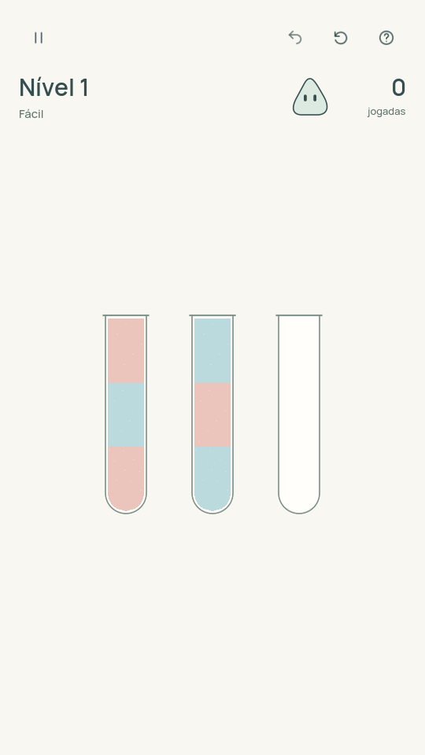
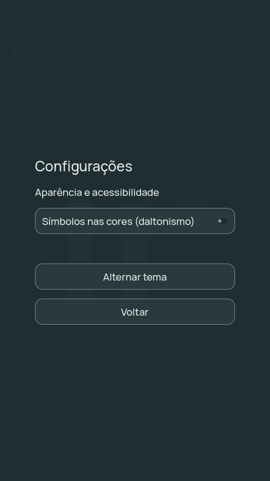
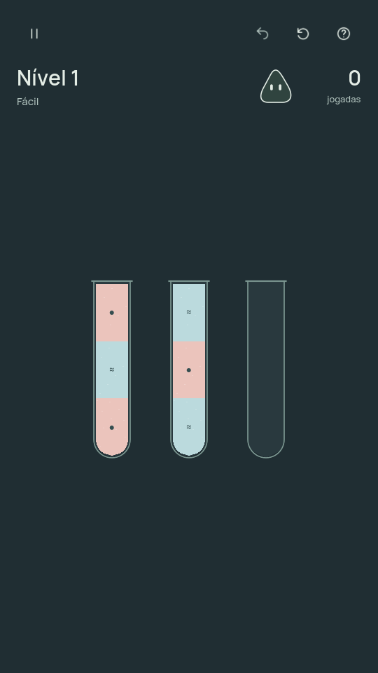

# Revisão da tela dos níveis

Data: 12/11/2026. Ajuste após avaliação do usuário da identidade A.

## Proposta aplicada ao protótipo

A tela de nível não exibe nome ou logo do aplicativo. Uma barra superior reúne menu da fase, desfazer, reiniciar e como jogar, somente por ícones. Os controles mantêm rótulos de acessibilidade e áreas de toque de pelo menos 48 unidades. Reiniciar continua exigindo confirmação; nenhuma ação destrutiva acontece no primeiro toque. Os botões grandes da parte inferior foram retirados.

A informação fica em uma linha de cabeçalho: título Nível à esquerda, dificuldade menor abaixo, mascote e número de jogadas à direita, com rótulo separado. Não há texto auxiliar permanente; retornos inválidos e desbloqueios geram mensagens breves, e a ausência de movimentos gera uma mensagem que oferece desfazer/reiniciar.

Os frascos agora são tubos de ensaio estreitos, de base arredondada, com corpo visual 52 × 252 e área de interação maior, 88 × 304. Até quatro tubos ficam na mesma linha do protótipo. O contorno destaca origem e destinos válidos. A areia mantém as cores pastéis e grãos discretos.

## Daltonismo

Por solicitação do usuário, os símbolos não foram removidos como recurso: passaram a ser **opcionais e desligados por padrão**. A opção “Símbolos nas cores (daltonismo)” fica em Configurações, acessível pelo menu da fase durante uma partida e pelo ícone de configurações no menu.

A mudança se aplica imediatamente aos tubos e é salva em `user://preferences.cfg`. A configuração pode ser ativada e desativada; as cores escondidas permanecem ocultas mesmo com a opção ativa. A preferência fica separada do estado do jogo, e o restante do progresso continua somente na sessão nesta etapa.

Sem os símbolos, a areia escondida usa tom neutro. A explicação correspondente foi atualizada para não depender do caractere “?”.

## Arquivos

- `scripts/main.gd`: novo cabeçalho, barra de ícones, mensagens breves e configurações.
- `scripts/bottle.gd`: tubos de ensaio e símbolos condicionais.
- `scripts/preferences.gd`: leitura e gravação da preferência de acessibilidade.
- `assets/icons/help.svg`: ícone de ajuda.
- `data/prototype_levels.json`: apenas texto do tutorial atualizado, sem mudança de tabuleiro ou mínimo.
- `tests/layout_test.gd`: configuração, persistência, privacidade das cores ocultas, controles no topo e confirmação.
- `tests/capture_layout.gd`: capturas reproduzíveis com preferências temporárias.

## Verificações

Passaram 283 verificações: regras 85, interface 13, solver/catálogo 142, identidade 18 e layout/configurações 25. Os seis cenários de CLI também passaram.

Foram conferidos os controles sem texto e com rótulos de acessibilidade, ausência da marca dentro do nível, confirmação de reinício, ajuda sem alteração de progresso, símbolos desligados por padrão, ativação e desativação imediatas, persistência em nova instância, proteção da areia escondida e expiração das mensagens. Os testes usam arquivos temporários de preferência para não alterar a configuração pessoal do usuário.

Capturas reais do Godot conferidas em claro e escuro, incluindo configurações e símbolos ativos. Os cálculos de jogadas, regras, IDs e mínimos das fases permanecem iguais.

## Git e sequência

Alterações no diretório oficial, sem commit ou push. Esta é uma revisão de apresentação do protótipo para avaliação; a produção da campanha de 150 fases ainda não foi iniciada.

## Ajuste de nomenclatura

O usuário confirmou substituir o ícone de pausa por reticências (⋯), com título, tooltip e rótulo de acessibilidade “Menu da fase”. O gesto Voltar e Escape abrem o mesmo menu. A mudança comunica navegação/configurações em um jogo sem cronômetro.
